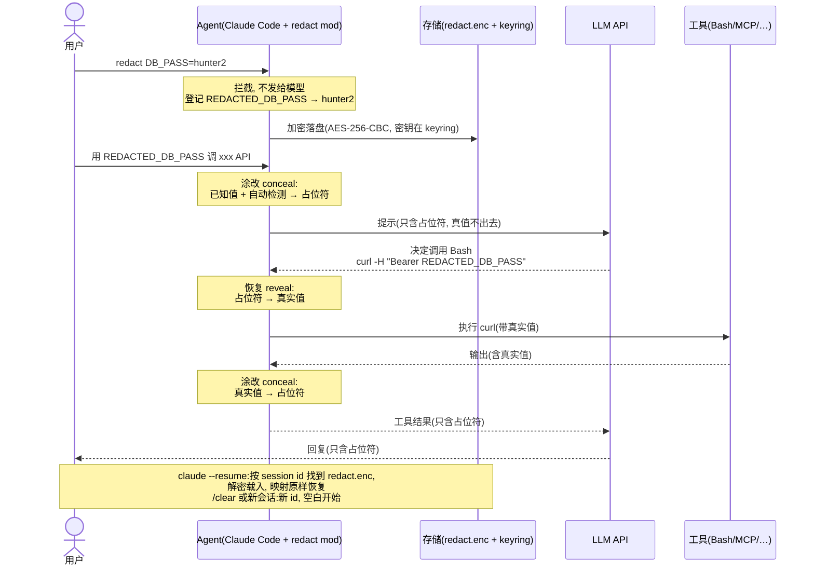

# redact-cross

Claude Code 的会话级密钥/PII 遮蔽插件(mod)。模型只看到 `REDACTED_<NAME>` 占位符;真实值只在工具执行时到达工具,从不进入模型上下文。

**目前仅支持 WSL(Linux)**;Windows、macOS 支持在路线图中。

需要 Claude Code v2.1.287+(mods 默认开启)。

## 工作原理

| 事件 | 行为 |
|---|---|
| `prompt.submit` | `redact NAME=value` 命令被拦截、不发给模型,值存入会话。其他提示中的已知值和自动检测到的敏感值替换为占位符。 |
| `tool.call` | 工具参数中的占位符在执行前换回真实值;工具输出中的真实值在返回模型前换回占位符。 |

## 工作过程时序图



不变式:LLM API 收发的一切字符串都不含真实值;真实值只在 Agent 进程内存和加密存储之间流转。

## 安装

1. 系统依赖(WSL 内):

   ```
   sudo apt install -y libsecret-tools   # secret-tool, 密钥存 gnome-keyring
   ```

   `openssl`(PATH 内任意 1.1.1+/3.x)和 `mv` 系统自带。

2. 安装插件:

   ```
   claude plugin install redact --marketplace breakersun/redact-cross
   ```

   仅当前项目:`--scope local`。

## 使用

```
redact DB_PASS=hunter2                  # 存一个(值 ≥4 字符, 引号自动剥离)
redact API_TOKEN: "abc..."              # = 或 : 均可; 一条提示可存多行
redact list                             # 列出当前占位符
redact forget API_TOKEN                 # 删除一个
redact clear                            # 全部删除; 自动检测的误报项会回显给模型
redact clear --force                    # 全部删除; 所有值回显给模型
```

之后直接在提示里用占位符:

```
curl -H "Authorization: Bearer REDACTED_API_TOKEN" ...
```

真实值再粘贴一次也没关系,进模型前会被改写。

**自动检测**(默认开,`userConfig.autoDetect` 可关)覆盖提示与工具输出:

- 按形状:邮箱、IBAN、Luhn 有效卡号、JWT、常见 API key 前缀(`sk-`、`ghp_`、`github_pat_`、`AKIA`、`xox*-`、`glpat-`、`AIza`、`ATATT3`)、`Bearer` 令牌、PEM 私钥;
- 按键名:`Authorization`、`X-Api-Key`、`Cookie` 等 credential header,以及键含 `password`、`secret`、`token`、`api_key`、`access_key`、`private_key`、`credential` 的 `key=value` / `key: value`(env、YAML、JSON、URL 参数)。

一个值被遮过一次后,本会话内以任何形态再现都会被遮,但只整词匹配:存 `check` 不会改写 `usage-check`。

## 会话与持久化

- 秘密绑定 session id,存于 `~/.claude/projects/<项目>/<session-id>/redact.enc`,AES-256-CBC + PBKDF2 加密,密钥 256-bit 存 gnome-keyring(`service=claude-code-redact`,`username=aes-key`),经 stdin/env 传递,不进 argv。
- `claude --resume`、进程重启、headless(Agent SDK、`claude -p`)下占位符照常解析。
- `/clear`、fork、新会话 → 新 id → 空白开始(自动检测仍会对新出现的值生效;手动存的需重新 `redact`)。
- 写入原子(temp + `mv`);文件损坏则移到 `redact.enc.corrupt-<ms>` 并空启动。
- **fail-closed**:解密失败、keyring 不可用时,提示被扣留/工具调用被拒绝,绝不放行明文。

## 限制

- 权限对话框显示的是命令真实执行形态(含真实值,仅你的终端可见)。
- 会话 `.jsonl` 的 prompt queue 记录保留输入原文——密钥请用单独的 `redact NAME=value` 发送,不要粘进工作提示。
- 长度 <4 的值拒收;含 `REDACTED_` 的值拒收(占位符前缀保留)。
- 输入会成为另一个模型提示的工具(`Agent`、`Skill`、`SendMessage` 及子代理类)只拿到占位符——子代理同进程可自行解析,跨会话/跨提供方无法解析,这是设计。
- 每个工具结果按存储值数扫描一次,开销随 值数 × 输出大小 增长;`redact.enc` 上限 4 MiB。
- keyring 必须解锁且免交互(WSL 重启后需保持;若锁定,hook 失败关闭,会话退化为内存模式)。

## 路线图

- [x] WSL/Linux:Secret Service(`secret-tool`)后端,Ubuntu 24.04 + gnome-keyring 验证
- [ ] Windows:DPAPI 后端
- [ ] macOS:Keychain(`security`)后端

## 测试

```
claude plugin test .    # 检测 + 生命周期,78 项
```

检测用例集中在 `tests/detect.test.ts`:`MASKED` 表(必须遮蔽)与 `KEPT` 表(必须原样放行)。新增格式 = 加一行测试,先红后改正则。

## 开发

```
claude --plugin-dir . --debug      # 保存即热重载
claude plugin validate .
```
